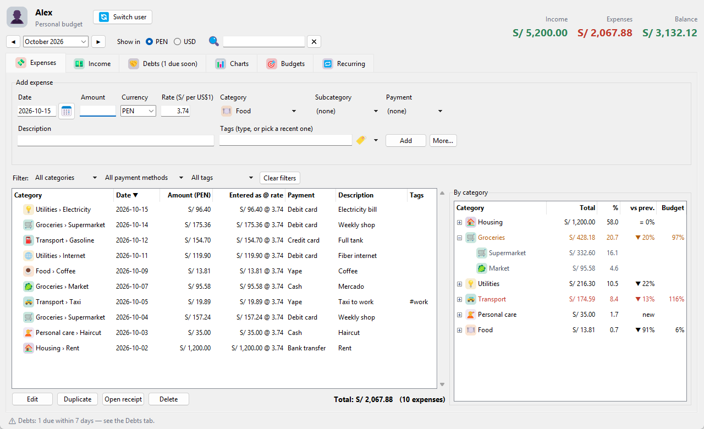
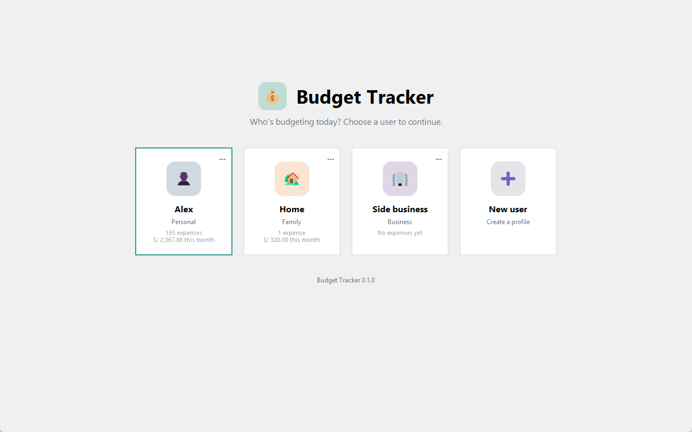
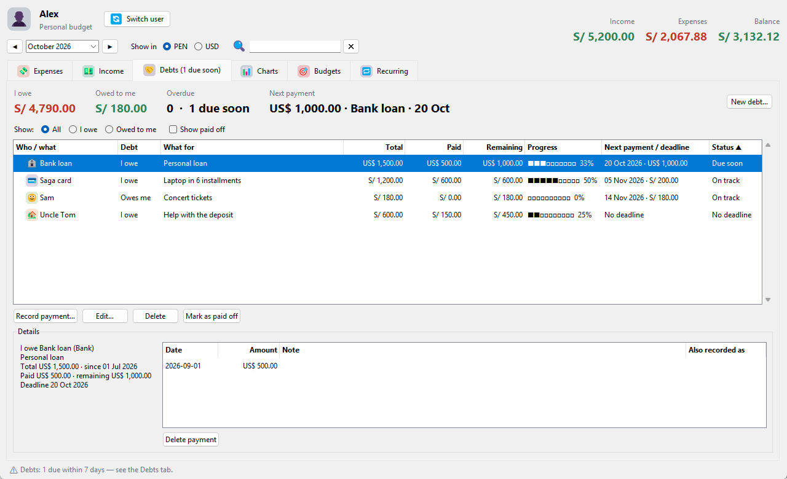
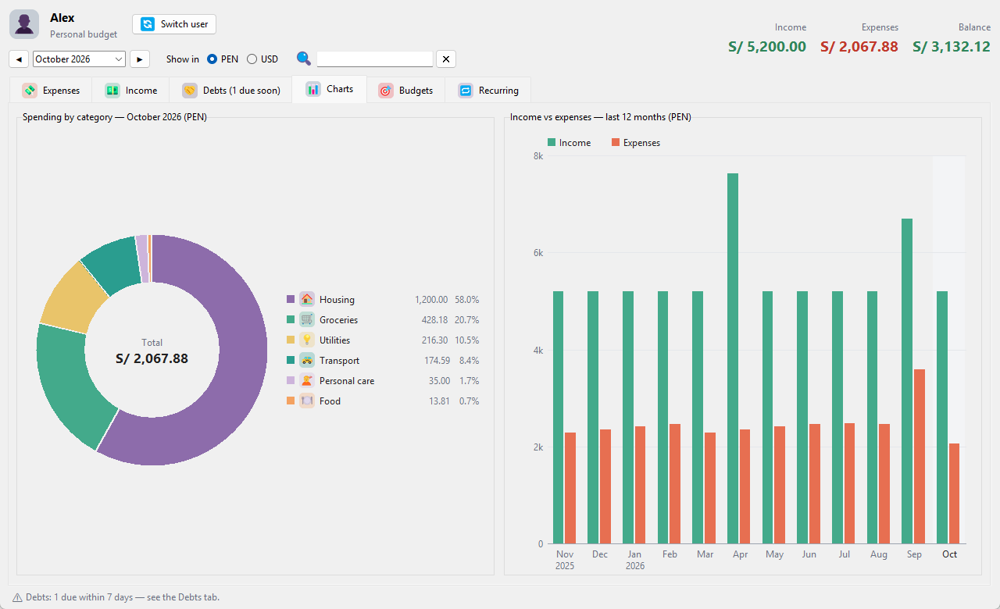
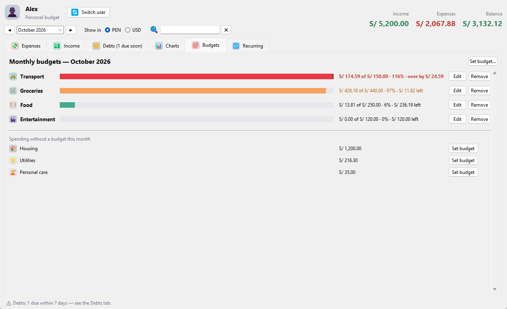

# 💰 Budget Tracker

[](https://github.com/caolaechea3d/budget-tracker/actions/workflows/tests.yml)
[](LICENSE)

A personal budget app for Windows that tracks **expenses, income, debts and budgets** in Peruvian
soles (PEN) and US dollars (USD). Several people can use it on the same computer, each with their
own data — and everything stays on your computer.



## Download

Get the latest version from [**Releases**](https://github.com/caolaechea3d/budget-tracker/releases/latest)
(Windows 10/11, 64-bit, no Python needed):

- **`…-setup.exe`** — installer with a Start-menu shortcut and uninstaller (no admin rights needed).
- **`…-portable.zip`** — unzip anywhere and run `Budget Tracker.exe`; your data stays in that folder.

The app isn't code-signed, so Windows may show "Windows protected your PC" the first time:
click **More info → Run anyway**.

## Features

- **Two currencies done right** — enter amounts in PEN or USD. Every record keeps the exchange rate
  of the day it was entered, so switching the whole app between PEN and USD never changes history.
- **Categories with subcategories and icons** — e.g. *Transport › Taxi*, with colorful emoji icons;
  fully editable, plus payment methods (cash, cards, Yape, Plin…) and tags (`#cusco-trip`).
- **Budgets** — a monthly limit per category, optionally split by subcategory (e.g. *Transport ›
  Car 1* and *Car 2*, adding up to Transport's total), with a different amount for specific months
  when needed (0 allowed). Progress bars turn orange at 80% and red when you go over.
- **Debts** — money you owe and money others owe you, with optional deadlines or monthly
  installments ("cuotas"), payment history, and reminders when something is due or overdue.
- **Recurring expenses** — rent, subscriptions and bills, offered for adding each month.
- **Charts** — spending by category and income vs. expenses over the last 12 months.
- **Daily expenses** — a table with a block per day: every category side by side with its items,
  descriptions and amounts, and the day's sums. Double-click an expense to edit it; export it to
  Excel with the same layout.
- **Month in review** — how a month went compared with a usual month: what stood out (big
  changes, unusually large expenses, possible duplicates), spending by category, biggest expenses,
  budgets and debts, plus where the current month is heading. Saved as a printable web page.
- **Bank statement import** — CSV files with `;` separators, `1.234,56` amounts and `DD/MM/YYYY`
  dates; duplicates are skipped.
- **Export** — a formatted Excel workbook (expenses and income sheets, filters, totals that
  follow the filter, print-ready) or plain CSV with readable headers and a totals line.
- **Everyday comforts** — undo/redo (Ctrl+Z / Ctrl+Y), search across all months, sortable
  columns, filters, a calendar date picker, receipts attached to expenses.
- **Several users** — a start screen to pick who's using the app; each user has separate data,
  receipts and backups.
- **Safe storage** — atomic saves (a crash never leaves a half-written file) and an automatic
  daily backup per user.

| | |
|---|---|
|  |  |
|  |  |

*Screenshots use made-up demo data (`tools/demo_data.py`).*

## How it's built

Python 3 with Tkinter for the interface, Pillow for the color icons and openpyxl for the Excel
export; data is plain JSON files.

```
expense_tracker/
  storage.py      data model (expenses, income, budgets, recurring) and the JSON store
  debts.py        debts, installment schedules and payments
  undo.py         undo/redo history
  reports.py      totals, comparisons, budget status, search
  daily.py        the daily expenses table
  review.py       the month in review (calculations and wording)
  review_html.py  the month in review as a printable HTML page
  importer.py     bank-statement CSV import
  exporter.py     CSV and Excel export (expenses and income, daily table)
  users.py        users, each with their own data folder
  paths.py        where data lives (from source, portable, or installed)
  cli.py          command-line interface
  gui/            the window: start screen, dialogs, widgets, charts
  gui/tabs/       one module per tab (expenses, income, debts, charts, reports, budgets, recurring)
tests/            unit tests (python -m unittest)
build.py          builds the Windows app with PyInstaller (+ Inno Setup installer)
```

Some design decisions:

- **Exchange rate per record.** The PEN/USD rate changes every day, so each expense, income and
  debt stores the rate it was entered with. Converting with today's rate would silently rewrite
  past months.
- **Money as `Decimal`**, never floats, so amounts like 0.10 + 0.20 are exact.
- **Undo by snapshots.** Before each undoable change the whole document is kept in memory; undo
  writes it back. Each step remembers a fingerprint of the data, so if something that isn't
  undoable changed it in between, undo refuses instead of overwriting that change.
- **One write per change.** Multi-part changes (e.g. a debt payment that also creates an expense)
  are applied to the document in a single atomic save — all or nothing.
- **Tabs share one load.** `refresh()` reads the data once and hands the same snapshot to every
  tab, so all tabs always agree.

## About this project

This app was built with AI assistance: the code was written with
[Claude Code](https://claude.com/claude-code) as a pair programmer, while I decided what to build
and how it should behave, and tested it as it grew. Commits note the AI co-author.

## Running from source

Requires Python 3 (developed and tested with 3.14) on Windows.

```
python -m pip install -r requirements.txt
python main.py
```

[Pillow](https://pypi.org/project/pillow/) draws the color icons; without it the app still works
with plain emoji. [openpyxl](https://pypi.org/project/openpyxl/) writes the Excel export. To try the
app with demo data instead of your own:

```
python tools/demo_data.py demo-data
set BUDGET_TRACKER_DATA=demo-data
python main.py
```

### Where data is stored

| How you run it | Data folder |
|---|---|
| From source (`python main.py`) | `data/` in the project folder |
| Portable zip | `data/` next to `Budget Tracker.exe` |
| Installed | `%APPDATA%\Budget Tracker\data` (kept on uninstall) |

The `BUDGET_TRACKER_DATA` environment variable overrides all of these. Inside it:

```
users.json                  the list of users and who was used last
users/<id>/expenses.json    that user's expenses, income, debts, budgets, recurring, categories…
users/<id>/receipts/        that user's receipts
users/<id>/backups/         automatic daily backups (last 30 kept)
users/_deleted/             data of deleted users (moved here, never erased)
logs/errors.log             details of unexpected errors
```

### Command line

```
python -m expense_tracker                                   # interactive menu
python -m expense_tracker add 18 transport -s Taxi -p Yape -t work -d "Taxi to office" --rate 3.72
python -m expense_tracker add 12 books --currency USD       # reuses the last rate
python -m expense_tracker edit <id> --rate 3.80 -s Gasoline # only the given fields change
python -m expense_tracker list --month 2026-09 --in USD
python -m expense_tracker summary --month 2026-09
python -m expense_tracker income add 5200 salary
python -m expense_tracker budget set transport 250
python -m expense_tracker debts --in USD                    # open debts; --all includes paid-off ones
python -m expense_tracker export expenses.csv --month 2026-09
python -m expense_tracker export budget.xlsx --month 2026-09 # Excel: expenses and income
python -m expense_tracker export income.csv --income
python -m expense_tracker backup
python -m expense_tracker users list
python -m expense_tracker --user Oficina list               # any command, for a specific user
```

Commands use the last user opened in the app unless you pass `--user NAME`.

### Tests

```
python -m unittest -v
```

They also run on GitHub for every push (see the badge above).

### Building the Windows app

```
python -m pip install -r requirements-dev.txt
python build.py
```

Creates `dist/BudgetTracker-<version>-portable.zip`, and `dist/BudgetTracker-<version>-setup.exe`
if [Inno Setup 6](https://jrsoftware.org/isinfo.php) is installed. The version is `__version__` in
`expense_tracker/__init__.py`.

**Publishing a release:** bump `__version__`, commit, then push a matching tag
(`git tag v0.2.0` and `git push origin v0.2.0`). GitHub builds both files on Windows and publishes
them as a release (`.github/workflows/release.yml`).

To refresh the README screenshots: `python tools/screenshots.py` (Windows; uses demo data).

## License

[MIT](LICENSE)
